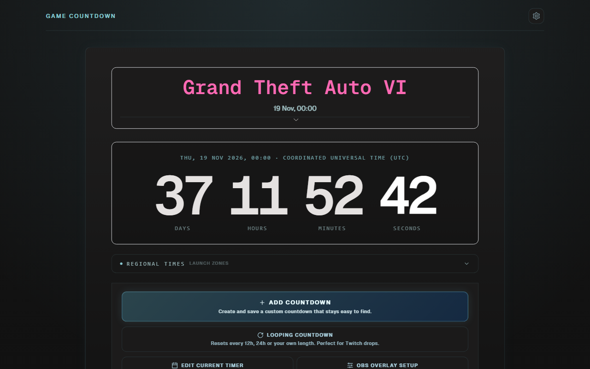

# Game Countdown

Countdown timers for game launches, betas, wipes and maintenance windows.
Every timer shows the same absolute moment for everyone, with local times for
the major release regions, and any timer can be dropped into OBS as a
browser-source overlay.

**Live site:** <https://game-countdown.pages.dev>



## Features

- **Built-in countdowns** for upcoming releases and events, maintained in
  [`src/data/default-games.ts`](src/data/default-games.ts).
- **Live updates.** The build publishes the built-in list as `/countdowns.json`.
  Open pages, including OBS sources, re-check it every 60 seconds and pick up
  date changes without a refresh.
- **Custom countdowns** saved in your browser, with a timezone-aware date picker.
- **Looping countdowns** that reset on a fixed cycle (1h, 6h, 12h, 24h, 7 days
  or custom), for things like daily Twitch drops.
- **Regional times** for each launch, plus DST-aware timezone handling.
- **OBS overlay mode** with a customiser for fonts, colours, background, border
  and glow. The settings are encoded in the link.
- **IGDB release feed** of upcoming PC games. Any listing with an exact day can
  be turned into a countdown.
- **Share links with previews.** A Cloudflare Pages Function rewrites the Open
  Graph tags so Discord and social embeds show the game and time remaining.

## Quick start

Requirements: [Node.js](https://nodejs.org) 20+ and [Bun](https://bun.sh)
(Bun is only used to run tests).

```bash
git clone https://github.com/Wilsman/game_countdown.git
cd game_countdown
npm install
npm run dev        # http://localhost:5173
```

The app works without any secrets. Only the IGDB release feed needs
credentials (see [IGDB feed](#igdb-feed)); without them that panel shows an
error and the rest of the app works normally.

## Scripts

| Command             | What it does                                       |
| ------------------- | -------------------------------------------------- |
| `npm run dev`       | Vite dev server with HMR, including the local IGDB API |
| `npm test`          | Run the test suite (`bun test`)                    |
| `npm run typecheck` | Type-check the app, config and Functions           |
| `npm run build`     | Type-check, then build to `dist/`                  |
| `npm run preview`   | Serve the production build locally                 |
| `npm run check`     | Tests + build. This is what CI runs                |

## Project layout

```text
src/
  App.vue               Page shell, theme and layout
  components/           Vue SFCs (TimerDisplay, ControlPanel, dialogs, ...)
  data/default-games.ts Built-in countdowns (most contributions land here)
  stores/timer.ts       Pinia store: active timer, custom timers, URL state
  lib/                  Framework-free logic: timezones, looping, IGDB, live sync
  hooks/                Composables (useNow, useLiveCountdowns)
  types/                Shared TypeScript types
functions/              Cloudflare Pages Functions (OG tags, OG image, IGDB proxy)
public/                 Static assets served as-is
scripts/                One-off utilities (e.g. image conversion)
docs/                   Screenshots and UI guidelines
```

## Adding or updating a countdown

Edit [`src/data/default-games.ts`](src/data/default-games.ts) and add an entry:

```ts
{
  id: "my-game-release",             // unique, stable, kebab-case. Used in share links.
  title: "My Game",
  titleColor: "#7ed2eb",
  targetDate: new Date("2027-03-01T17:00:00Z"), // always UTC with a trailing Z
  targetTimezone: "America/Los_Angeles",        // zone the publisher announced in
  type: "game",
},
```

- Write `targetDate` as an ISO 8601 UTC string. Don't use
  `new Date(year, month, ...)`, because that is interpreted in the viewer's
  local timezone.
- Add a comment with the announced local time and a source if possible.
- If no launch hour has been announced, use `T00:00:00Z` with `targetTimezone: "UTC"`
  and say "time not announced" in the comment.
- Don't rename an existing `id`. Existing share and OBS links depend on it.
- Remove entries once the event has passed.

`npm test` checks that ids are unique and that no entry predates the last prune
reference date in `src/data/__tests__/default-games.spec.ts`.

## Share and overlay links

Links carry their state in the query string:

| Param      | Meaning                                                   |
| ---------- | --------------------------------------------------------- |
| `game`     | Built-in countdown id. Follows live updates to that entry |
| `date`     | Target instant (ISO 8601 UTC) for custom timers           |
| `title`    | Custom title                                              |
| `timezone` | IANA timezone used for display                            |
| `loop`     | Cycle length in minutes. `date` is then the reset anchor  |
| `obs=1`    | Overlay mode: hides the page chrome for OBS browser sources |
| `override=1` | Keep this link's `date`/`title` instead of live updates |

The overlay customiser adds styling params (`font`, `color`, `bg`, `tsize`, ...).
Use **OBS Overlay setup** in the app to generate them instead of writing them by hand.

## IGDB feed

Upcoming releases come from the Pages Function at `/api/igdb/releases`. It
exchanges Twitch application credentials for an IGDB app token, so the secret
never reaches the browser.

1. Create an app at <https://dev.twitch.tv/console/apps>.
2. Put the credentials in an untracked `.dev.vars` file in the repo root:

   ```text
   TWITCH_CLIENT_ID="..."
   TWITCH_CLIENT_SECRET="..."
   ```

3. Run `npm run dev`. The Vite dev server serves `/api/igdb/releases` itself.
   To run the real Pages runtime instead, use `npm run build` and then
   `npx wrangler pages dev dist`.

IGDB dates have day precision only, so countdowns created from the feed target
the UTC start of that day and are labelled **Date only**.

## Deployment

The site is deployed with Cloudflare Pages from the `main` branch. The build
command is `npm run build`, the output directory is `dist`, and Functions are
loaded from `functions/`. Each pull request gets a preview deployment. In
production, set `TWITCH_CLIENT_ID` and `TWITCH_CLIENT_SECRET` as encrypted
variables under **Settings → Variables and Secrets**.

## Contributing

Contributions are welcome, and AI coding agents are fine to use. Please read
[CONTRIBUTING.md](CONTRIBUTING.md). Agents should also read [AGENTS.md](AGENTS.md).

## Tech stack

Vue 3 (`<script setup>`), TypeScript (strict), Vite, Pinia, Tailwind CSS,
date-fns, Bun test runner, Cloudflare Pages + Functions.

## License

[MIT](LICENSE)
